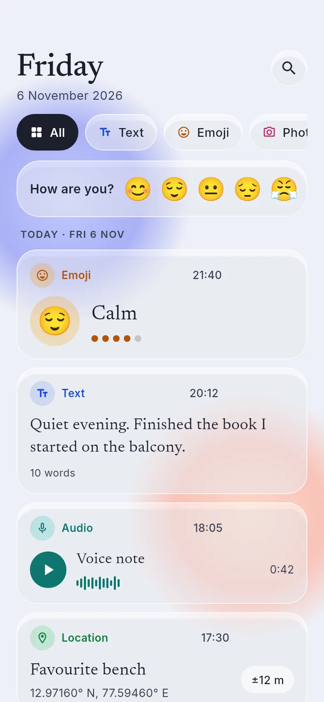
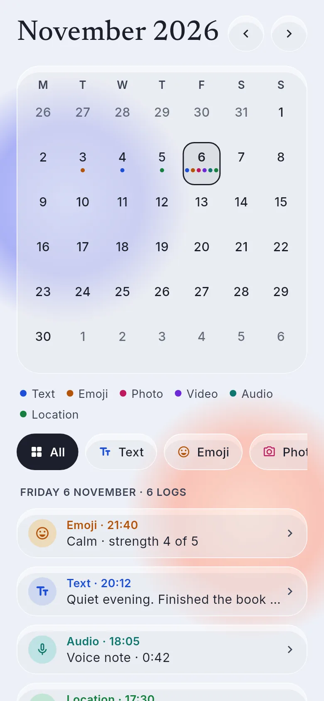
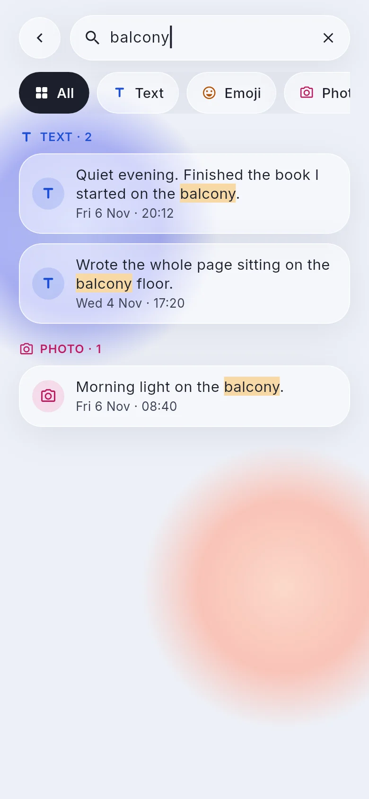
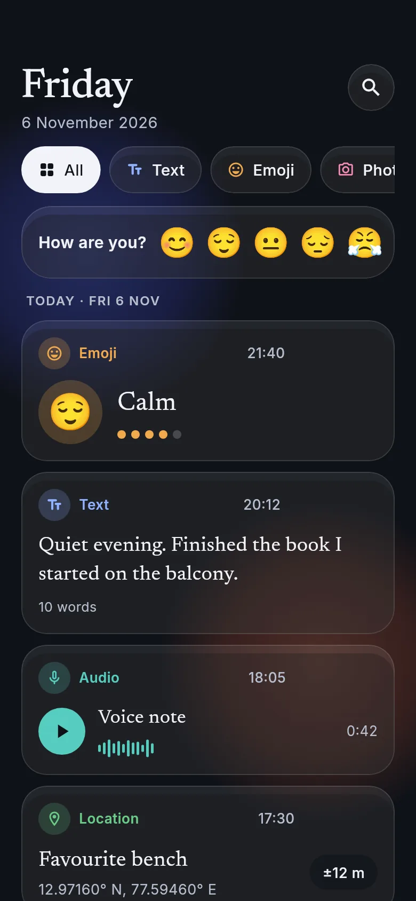

<div align="center">

<picture>
  <source media="(prefers-color-scheme: dark)" srcset="design/logo/lockup-dark.svg">
  
</picture>

### A private journal of your days

Six kinds of log, encrypted on your phone. No account, no cloud.

[](https://github.com/saranmahadev/Moment/actions/workflows/ci.yml)
[](https://github.com/saranmahadev/Moment/releases/latest)
[](LICENSE)

[**Website**](https://saranmahadev.github.io/Moment/) · [**Download**](https://github.com/saranmahadev/Moment/releases/latest) · [**Changelog**](CHANGELOG.md) · [**Contributing**](CONTRIBUTING.md)

<a href="https://saranmahadev.github.io/Moment/#film">
  
</a>

<a href="https://saranmahadev.github.io/Moment/#film"><sub>Watch the one-minute film, with narration and captions</sub>
</a>

</div>

## What it is

Moment is a life journal for your phone. It keeps what you write, feel, see, hear and where you were, as six **separate** kinds of log that are never merged into one mixed-up entry:

| Kind | What it holds |
|---|---|
| **Text** | What is on your mind, in your own words |
| **Emoji** | How you feel and how strongly, in one tap |
| **Photo** | What you saw, with location data stripped on the way in |
| **Video** | How it moved, kept exactly as recorded |
| **Audio** | A voice note, with a title and a note |
| **Location** | Where you were: a pin, a name and a note |

Everything stays on the device, in an encrypted database. There is nothing to sign up for.

> **Status:** version 1.0.0-rc.1, the release candidate for 1.0. Every screen exists and the app is usable day to day; 1.0.0 follows once the candidate has been tried on real phones. See [Status and roadmap](#status-and-roadmap).

## Screens

<table>
  <tr>
    <td></td>
    <td></td>
    <td></td>
    <td></td>
  </tr>
  <tr>
    <td align="center">Home</td>
    <td align="center">Calendar</td>
    <td align="center">Search</td>
    <td align="center">Dark theme</td>
  </tr>
</table>

More on the [website](https://saranmahadev.github.io/Moment/#screens). These are renders from the test suite, with placeholder frames where photos and video would be.

## Features

- **Home** shows today's logs of every kind in one calm feed, with a one-tap mood row you can customise.
- **Library** has a section for each kind of log.
- **Calendar**: a month at a glance with a dot per kind on each day. Days are the ones logs were made on, so travel and daylight saving move nothing.
- **Widget** (Android): your streak and a button for each log type on the home screen. It never opens the journal; you choose whether it shows the streak at all.
- **Streaks**: days in a row, a heatmap of your year and milestones, with grace days you set. Worked out on the phone from your logs; nothing extra is stored or sent.
- **Search**: full-text search as you type across everything you have written, named or captioned, on the device (SQLite FTS5).
- **Built for years of logs**: tested with 20,000 logs, which open, scroll, search, back up and restore without slowing down.
- **Encrypted backup**: one passphrase-protected `.moment` file holds every log and media file. Restore is all or nothing.
- **Export** to Markdown, JSON and the original files, for the kinds you choose.
- **App lock**: a PIN, with Face ID or fingerprint. Wrong PINs slow guessing down, and while the lock is on the app switcher shows no preview of the journal.
- **Diagnostics**: a short log of errors kept on the phone (never what you wrote), for you to read or share yourself.
- **Trash**: deleted logs wait 30 days, then go for good, files included.
- **Light and dark** themes, and **Reduce Transparency** for solid surfaces.
- **Accessible**: every control is labelled for screen readers, tap targets are at least 44 pt, and text fits at 200% size.
- **Evening reminder**: a notification made on the phone, which never shows anything from the journal.

## Privacy

Moment is private by how it is built, not by a policy.

- **No account, no cloud, no analytics, no ads.**
- **Encrypted at rest.** The database is encrypted (SQLite3MultipleCiphers) with a random key made on the device and kept in the Keychain or Keystore. Backups are encrypted with a passphrase only you know.
- **One exception, off by default.** "Look up place names" sends the coordinates of a new pin to OpenStreetMap to suggest a name. It is the only thing in the app that uses the internet, and with the switch off the app is not even handed the code that does it.

This is checked, not just claimed:

- `test/location/network_boundary_test.dart` keeps network code to one file, one address, over HTTPS, and keeps HTTP and geocoding packages out of the dependencies.
- `tool/check_manifest.dart` lists every permission the Android release build asks for and fails CI on ones a private journal never needs (background location, advertising id, contacts, SMS, call log).
- The **Live check** workflow asks the real place-name service two questions, to confirm the one request the app can send still works.
- `tool/release_check.dart` runs on every release build: permissions exactly as listed, Android backup off, the encrypted SQLite inside each APK, the signing key, the version and the sizes.

The [privacy policy](https://saranmahadev.github.io/Moment/privacy.html) says the same in plain words.

Found a security or privacy problem? Please see [SECURITY.md](SECURITY.md).

## Install

### Android

Download the APK from the [latest release](https://github.com/saranmahadev/Moment/releases/latest) and open it on your phone. Android will ask you to allow installing from your browser or file manager.

> Until 1.0, releases are signed with a temporary key, so a new version does not install over the old one. Back up in the app (Settings → Privacy and backup), uninstall, install the new version, then restore.

### iPhone

Moment is not in the App Store yet. You can build and run it yourself with Xcode: see below.

## Build it yourself

You need [Flutter](https://docs.flutter.dev/get-started/install) 3.47.9, the version CI uses.

```sh
git clone https://github.com/saranmahadev/Moment
cd Moment
flutter pub get
dart run build_runner build --delete-conflicting-outputs   # generates the database code
flutter run                                                # on a connected phone or simulator
```

To build a release APK: `flutter build apk --release`.

## Development

```sh
flutter test                         # everything, including a 1 GB video test
flutter test --exclude-tags slow     # the quick run
flutter analyze
dart format .
dart run build_runner watch --delete-conflicting-outputs
```

Work is test-first: a failing test is committed before the change that makes it pass. [CONTRIBUTING.md](CONTRIBUTING.md) has the rules, and `docs/WORKFLOW.md` the full working agreement.

### Checks on every screen

`test/support/screen_cases.dart` lists every screen of the app. `test/gate/all_screens_test.dart` runs each through the same checks: no live blur, Reduce Transparency in both themes, a label and a 44 pt target for every control, text at 200% size, and a light and a dark baseline image. A new screen joins all of them by being added to that list.

```sh
# Regenerate the baselines after a deliberate visual change
flutter test --update-goldens test/gate/all_screens_test.dart --plain-name goldens

# Write every screen to build/previews/ as PNG (light, dark, glass, solid)
flutter test --run-skipped --tags preview test/gate/previews_test.dart
```

### Where things are

| Path | What is there |
|---|---|
| `lib/data/` | Encrypted database (Drift), the one repository every screen goes through, media storage |
| `lib/domain/` | The six kinds of log |
| `lib/design/` | Tokens (colours, glass recipes), theme, shared widgets |
| `lib/home/`, `lib/library/`, `lib/calendar/`, `lib/search/`, `lib/settings/`, `lib/privacy/` | Screens |
| `lib/text/`, `lib/emoji/`, `lib/photo/`, `lib/video/`, `lib/audio/`, `lib/location/` | Creating and viewing each kind |
| `lib/backup/`, `lib/export/` | Encrypted backup, restore and export |
| `test/` | Tests, mirroring `lib/`; `test/gate/` holds the every-screen checks |
| `design/` | Mockups, the logo and the film, with the scripts that build them |
| `site/` | The project website, published to GitHub Pages |
| `docs/` | Roadmap, working agreement and store text (`docs/store/`) |

### Releasing

Run the **Release** workflow (Actions → Release → Run workflow) with the version. It checks, builds, tags and publishes the APK in one go. See `docs/WORKFLOW.md`, "Releases".

## Status and roadmap

| Version | What | State |
|---|---|---|
| 0.1 | Encrypted storage, app lock, Text and Emoji | Done |
| 0.2 | Photo, Audio, encrypted backup and export | Done |
| 0.3 | Video and Location | Released |
| 0.4 | Calendar, Search, Settings, dark theme | Released |
| 0.5 | Streaks | Released |
| 0.6 | Home screen widget (Android) | Released |
| 1.0 | Polish, hardening, signed releases | Release candidate |

The plan for each phase, with its tests and exit gate, is in [docs/ROADMAP.md](docs/ROADMAP.md).

## Contributing

Contributions are welcome. Start with [CONTRIBUTING.md](CONTRIBUTING.md): it explains the test-first workflow and the handful of rules that protect the privacy promise (no new network access, no new permissions without discussion).

## Built with

- [Flutter](https://flutter.dev) and [Drift](https://drift.simonbinder.eu) on [SQLite3 Multiple Ciphers](https://utelle.github.io/SQLite3MultipleCiphers/)
- [Inter](https://rsms.me/inter/) and [Newsreader](https://github.com/productiontype/Newsreader), under the SIL Open Font License
- Place names, when turned on, from [OpenStreetMap](https://www.openstreetmap.org/copyright) contributors

## Licence

Moment is free software, licensed under the [GNU General Public License v3.0](LICENSE). You can use it, study it, change it and share it; versions you distribute must stay under the same licence.
